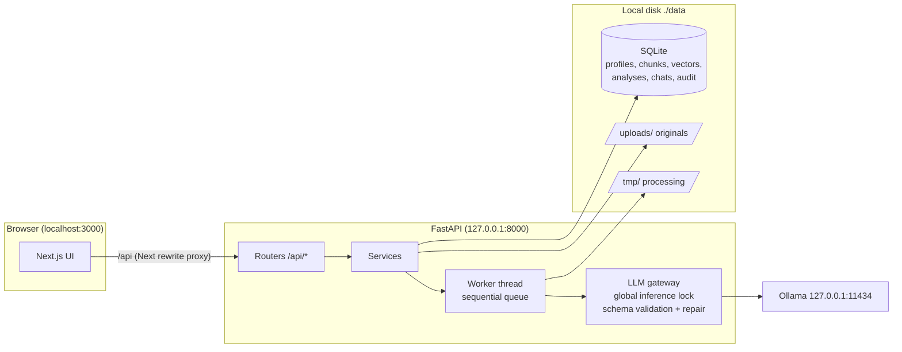

# Architecture — Recruiter Copilot Local

## 1. Environment findings (inspection of 2026-11-06)

| Item | Finding | Consequence |
|---|---|---|
| Repository | Empty | Greenfield project |
| Ollama | v0.40.14 at `http://localhost:11434`, reachable | Structured outputs (`format` = JSON schema), `keep_alive` unload and `/api/ps` are all available |
| Models | qwen3:8b (Q4_K_M, 5.2 GB), qwen2.5:7b (4.7 GB), mistral-nemo 12B (7.1 GB), hermes3:8b, llama3.x, nomic-embed-text (274 MB, 768-d), moondream (1.7 GB, vision) | qwen3:8b is fully offloaded to the RTX 4070 (≈5.6 GB VRAM at 4k ctx), ≈35 tok/s. mistral-nemo 12B does **not** fit fully in 8 GB VRAM at 8k ctx → partial CPU offload, slower |
| GPU | RTX 4070 Laptop, 8 GB VRAM | One 7–8B Q4 model + embedding model at a time |
| RAM | 16 GB, often ~85–90 % used by other apps | RAM headroom is monitored; inference is refused with a clear message below a configurable floor |
| Disk | ~50 GB free | No model downloads; documents are small |
| Tools | Python 3.12, Node 22, pnpm/npm, Docker 27, git | Native dev mode without Docker is primary |
| OCR | Tesseract **not installed** | OCR uses `rapidocr-onnxruntime` (pip wheel shipping its own ONNX models, CPU, fully offline) – no system install required |

## 2. Stack and trade-offs

| Layer | Choice | Why / trade-off |
|---|---|---|
| Frontend | Next.js 15 (App Router), React 19, TypeScript, Tailwind, shadcn/ui-style components (Radix primitives), Lucide | As requested. shadcn components are vendored in `frontend/components/ui` (no CLI/network needed at build time) |
| Backend | Python 3.12, FastAPI, Pydantic v2, SQLAlchemy 2 | As requested. Pydantic schemas are reused as Ollama JSON-schema constraints |
| Database | SQLite (WAL, `foreign_keys=ON`, `secure_delete=ON`) | Single file, transactional deletion, no server |
| Vector search | **Embeddings stored as float32 BLOBs in SQLite + NumPy cosine search, always pre-filtered by `candidate_id`** (instead of FAISS) | At recruiter scale (≤ a few thousand CVs ⇒ ≤ ~50k chunks) brute force is < 20 ms. Concrete advantages: (1) deleting a candidate deletes its vectors **in the same SQL transaction** – FAISS would require an ID-map index plus rebuild, and leaves a second copy on disk; (2) candidate isolation is enforced by the SQL `WHERE candidate_id IN (...)` before any similarity is computed, not by post-filtering. FAISS can be plugged in later behind `VectorStore` if volumes grow |
| PDF | `pypdfium2` (Apache-2/BSD) | Text extraction + page rendering for OCR, robust on malformed files |
| DOCX | `python-docx` | Paragraphs + tables |
| OCR | `rapidocr-onnxruntime` | See above; optional, the app degrades gracefully if missing |
| LLM runtime | Ollama REST only, host restricted to loopback (allow-list) | No external inference provider can be configured by mistake |
| Jobs | One in-process worker thread + persistent status in DB | Guarantees **sequential inference** (one LLM call at a time, global lock) – right for 8 GB VRAM |

## 3. Component view

Backend packages (`backend/app`):

- `config.py` – env-based settings (`RCL_*`), runtime overrides persisted in `app_settings`.
- `db.py`, `models.py` – SQLAlchemy engine, pragmas, ORM.
- `schemas/` – Pydantic API + LLM output schemas.
- `llm/` – Ollama client (loopback guard, timeouts, typed errors), gateway (lock, resource check, structured generation with repair), prompts (injection-resistant).
- `services/` – documents, storage, privacy (redaction / injection detection), extraction, evidence verification, chunking + embeddings, retrieval, analysis, assistant, comparison, interview, deletion, hardware, benchmark.
- `api/` – routers.
- `worker.py` – the processing queue.

## 4. Key design rules

1. **LLM output never touches the DB unvalidated.** Every call uses an Ollama JSON-schema constraint, then Pydantic validation, then up to N controlled repair attempts, then post-processing (evidence verification, data-minimisation filter).
2. **Evidence verification.** Each quote the model claims as evidence is searched (normalised, fuzzy) in the CV text. Unverifiable quotes are flagged; a "demonstrated" status without verifiable evidence is downgraded to "cannot be determined". Extraction confidence is computed from the verified-evidence ratio, not self-reported by the model.
3. **No ranking.** No API returns a score, rank, winner or reject/hire recommendation. Statuses are per criterion only.
4. **Prompt-injection resistance.** CV text is wrapped in nonce delimiters, delimiter look-alikes are neutralised, the system prompt declares the document as untrusted data, output is schema-constrained, and suspicious instruction-like passages are detected and shown to the recruiter.
5. **Data minimisation by construction.** Sensitive lines (birth date, age, marital status, nationality, gender, religion, health, address…) are redacted from the text **before** it is stored or shown to a model; the extraction schema has no field for them.
6. **Candidate isolation.** Retrieval functions require an explicit candidate-id set; chat sessions are bound to their candidates.
7. **Sequential, resource-aware inference.** One global lock, RAM check before loading a model, previous model unloaded (`keep_alive: 0`) when the active model changes, bounded `num_ctx`.
8. **Logs carry no personal data** – only UUIDs, event types and durations.

## 5. Roadmap

| Level | Content | Status (2026-11-06) |
|---|---|---|
| 0 | Inspection, architecture, scaffolding, synthetic data generator | ✅ done |
| 1 – Core MVP | Dashboard, import (PDF/TXT/DOCX, multi, duplicate detection, statuses), text extraction, Ollama connection, structured extraction with validation/repair, profiles, jobs, basic analysis, deletion + report, privacy docs, tests | ✅ done, tested (fake + real Ollama), UI verified |
| 2 – Assistant | Chunk embeddings (nomic-embed-text), semantic search, chat with citations & isolation, comparison, interview prep, model settings/monitoring | ✅ done, tested, UI verified |
| 3 – Explainability & privacy | OCR for scanned PDFs, evidence traceability UI ("show in CV"), confidence, lifecycle events, verifiable deletion, data-flow view, processing register, audit checklist | ✅ done, tested |
| Bonus | Benchmark suite + dashboard, processing queue, export of analyses (Markdown/print) | ✅ done. Backup/restore, multiple LLM profiles: not done |
| Next | Authentication & roles, encryption at rest, automatic retention, image (JPG/PNG) import, i18n (FR UI) | planned |
