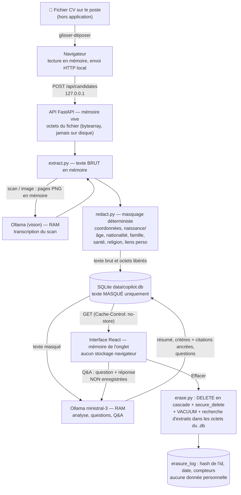

# Livrable B — Cycle de vie d'un CV dans Recruiter Copilot

Ce que fait **le code tel qu'il est**, pas une architecture idéale. Tout tourne sur le poste du recruteur ; aucune connexion sortante (Ollama, API et interface écoutent sur `127.0.0.1`).

## Copies du CV, où elles vivent, qui y accède, combien de temps

| # | Copie | Où | Contenu | Durée | Effacée par « Effacer » ? |
|---|---|---|---|---|---|
| 1 | Fichier d'origine | disque du recruteur (ex. dossier téléchargé) | CV complet | tant que le recruteur le garde | **Non** — hors application, à supprimer à la main |
| 2 | Fichier en cours d'envoi | mémoire de l'onglet | CV complet | quelques ms | n/a (mémoire) |
| 3 | Octets reçus + texte brut | mémoire du processus API | CV complet | jusqu'au masquage (secondes) | n/a ; **jamais écrit sur disque** (parseur multipart en mémoire, testé : aucun fichier temporaire) |
| 4 | Pages d'un scan | mémoire API → mémoire Ollama | image complète **non masquée** (photo comprise) | le temps de la transcription | n/a (mémoire) |
| 5 | Texte masqué | `data/copilot.db`, table `documents` | CV sans données écartées | jusqu'à l'effacement | **Oui** |
| 6 | Nom affiché | `candidates.display_name` | nom du fichier puis nom trouvé dans le CV | jusqu'à l'effacement | **Oui** |
| 7 | Analyse, citations, questions | tables `analyses`, `evidence`, `questions` | extraits du texte masqué | jusqu'à l'effacement ou ré-analyse | **Oui** (cascade) |
| 8 | Contexte du modèle | RAM d'Ollama | texte masqué, question Q&A | tant que le modèle reste chargé (~5 min par défaut) | Non vérifiable par l'app ; disparaît au déchargement du modèle |
| 9 | Fiche affichée | mémoire de l'onglet | texte masqué + analyse | jusqu'au changement de page / rechargement | n/a ; `no-store` empêche le cache disque du navigateur |
| 10 | Q&A | mémoire onglet + Ollama | question et réponse | le temps de la conversation | jamais stocké |
| 11 | Preuve d'effacement | table `erasure_log` | sha256(id), date, compteurs | permanente | — (ne contient aucune donnée personnelle) |

Pas de copie : pas de `-journal`/`-wal` sur disque (`journal_mode=MEMORY`, `temp_store=MEMORY`), pas de log contenant noms, fichiers ou texte, pas de localStorage/IndexedDB, aucune police ou CDN externe.

## Effacement — ce que la preuve démontre

1. Avant suppression, l'app prélève des extraits propres à ce CV (texte masqué + nom).
2. `DELETE` du candidat → cascade sur documents, analyses, évidences, questions.
3. `secure_delete=ON` (pages écrasées) puis `VACUUM` (fichier réécrit sans pages libres).
4. Vérification : 0 ligne restante par table **et** 0 occurrence des extraits dans les octets du fichier `.db` réellement ouvert.
5. La preuve (`verified`, nb d'extraits recherchés, état du VACUUM) est affichée et journalisée. Si le VACUUM échoue ou si aucun extrait n'a pu être vérifié, la preuve dit **non vérifié** au lieu de mentir.

Mesuré (bout-en-bout réel, 3b) : effacement en 100 ms, 13 extraits recherchés, 0 trouvé, toutes tables à 0.

## Limites assumées
- La copie n°1 (fichier source) n'est pas gérée par l'application.
- Sur SSD, l'ancienne version du fichier `.db` réécrit par VACUUM peut subsister dans des blocs libres jusqu'à leur réutilisation (le système de fichiers décide) → mitigation : chiffrement du disque (BitLocker).
- Les images de scan sont transmises au modèle local **avant** masquage (le masquage s'applique à la transcription).
- La RAM d'Ollama (n°8) n'est pas purgée explicitement à l'effacement.
