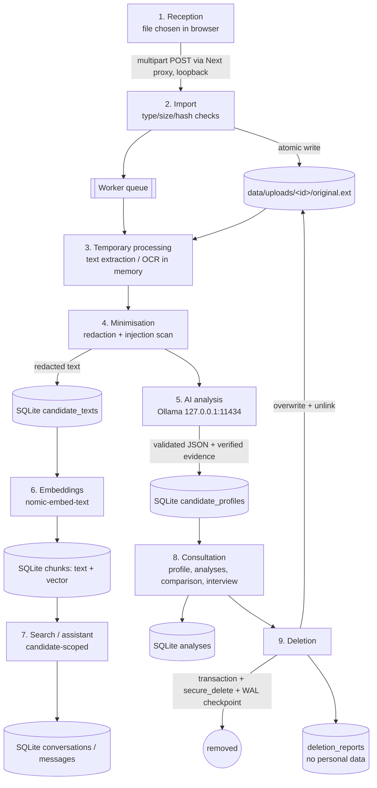

# Data lifecycle of a CV

Real journey of a CV through the application, as implemented.

## Step by step

| # | Step | Data involved | Storage location | Copies created | Components | Retention | Deletion |
|---|---|---|---|---|---|---|---|
| 1 | Reception | Full original file | Browser memory. Optional client-side preview (blob URL, revoked) | Browser memory only | Next.js page | Until upload | Tab close |
| 2 | Import | Original bytes, SHA-256, sanitised filename, size, type | `data/uploads/<uuid>/original.<ext>` (temp `.part` file in the same folder, then atomic rename). Starlette may spool uploads > 1 MB to the OS temp folder during the request | Original on disk. Hash + filename in `candidates` | FastAPI `/api/candidates/upload`, `services/storage.py` | Until candidate deletion (or right after text extraction if `keep_original_files=false`) | Overwrite with zeros + unlink. Starlette deletes its spool file at request end |
| 3 | Temporary processing | Raw text, rendered page images (OCR) | **Memory only** (no temp files written). `data/tmp/<uuid>/` reserved and wiped on deletion | None persistent | `services/documents.py`, `services/ocr.py` | Duration of the task | Garbage-collected |
| 4 | Text extraction & minimisation | Redacted text, section offsets, redaction counts, e-mail, phone, injection flags (short excerpt) | `candidate_texts`, `candidates` | Redacted text (1 copy) | `services/privacy.py`, `services/candidates.py` | Until deletion | DB transaction |
| 5 | AI analysis | Redacted text (truncated to context) inside prompt | Ollama process memory (GPU VRAM / RAM, KV cache) | None on disk: Ollama does not persist prompts | `llm/gateway.py`, Ollama | Until model unload / cache overwrite (`keep_alive`) | Unload model (AI settings) |
| 6 | Structured storage | Profile JSON (skills, experience…) with evidence + verification, model, confidence | `candidate_profiles` | 1 | `services/candidates.py` | Until deletion | DB transaction |
| 7 | Embedding generation | Text chunks + 768-d vectors | `chunks` (same row as the text) | 1 | `services/vector_store.py`, Ollama embed | Until deletion | DB transaction (same as the rest) |
| 8 | Search / assistant | Question, retrieved chunks, answer, citations | `conversations`, `conversation_candidates`, `chat_messages` | Answers may quote CV content | `services/assistant.py` | Until candidate or conversation deletion | Conversation removed with **any** candidate it involved |
| 9 | Consultation / analysis | Per-criterion assessments with quotes, interview questions | `analyses` | Quotes | `services/analysis.py`, `services/interview.py` | Until candidate or job deletion | DB cascade |
| — | Audit | Event type, ids, counts, model, durations (**no content**) | `lifecycle_events`, `data/logs/app.log` (UUIDs only) | — | `services/events.py` | Events: until candidate deletion. Log file: rotating 3 × 2 MB | Candidate events deleted. Rotated logs keep only UUIDs |
| — | Export (optional) | Markdown export of an analysis | User's Downloads folder | **Outside the app** | Browser | Not managed | Must be deleted manually |
| 10 | Deletion | — | `deletion_reports` keeps the former UUID, counts and checks only | — | `services/deletion.py` | Indefinite (audit) | Can be removed manually from the DB |

## Deletion procedure (step 10)

1. Collect the conversations linked to the candidate.
2. In **one transaction**, delete chat messages, conversation links, conversations, analyses and interview preparations, chunks and embeddings, extracted text, profile, lifecycle events and the candidate row. `ON DELETE CASCADE` is a second safety net.
3. `PRAGMA wal_checkpoint(TRUNCATE)`. `secure_delete=ON` zeroes the freed pages in the DB file.
4. Overwrite the original and temporary files with zeros, then unlink them and the folders.
5. Verify: re-count every table, check the folders, run a scoped search, look up the API record.
6. Store and display the report. The test suite additionally scans the raw `.sqlite3` bytes for the deleted CV's strings.

Limitations: [known-limitations.md](known-limitations.md#deletion).
